

# Práctica 3: Movimiento y Físicas

Manuel Cadenas García \<[alu0101636849@ull.edu.es](mailto:alu0101636849@ull.edu.es)\>

---
---

## Parte 1: Introducción a las físicas 3D

### Ejercicio 1
Los objetos 3D creados ya tienen su propio collider, por lo que solo añadimos un `Rigidbody` al cubo.
No ocurre nada, el cubo no tiene ninguna fuerza que lo haga moverse porque la gravedad se cancela con la fuerza de la superficie del plano en modo de collider.

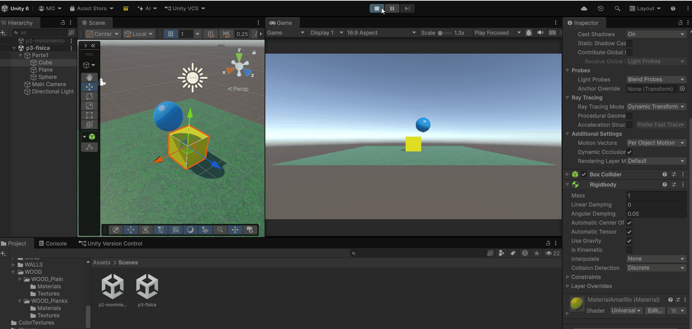

---

### Ejercicio 2

Añadimos un `Rigidbody` a la esfera.
La esfera cae y rebota primero con el cubo y después con el plano. Finalmente rueda hasta caer fuera de este y desaparece de la vista de la cámara.

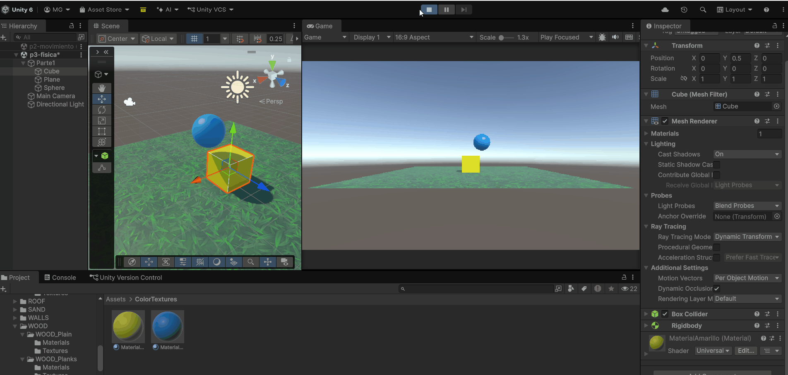

---

### Ejercicicio 3

Aplicamos `is Kinematic` a la esfera.
La esfera no cae, se queda flotando en el aire y no interactúa con ningún objeto si no hacemos nada, equivalente al ejercicio 1.
Si forzamos que el cubo interactúe con la esfera, se aplica una fuerza al cubo y este es repelido por la esfera, pero la esfera no se mueve.

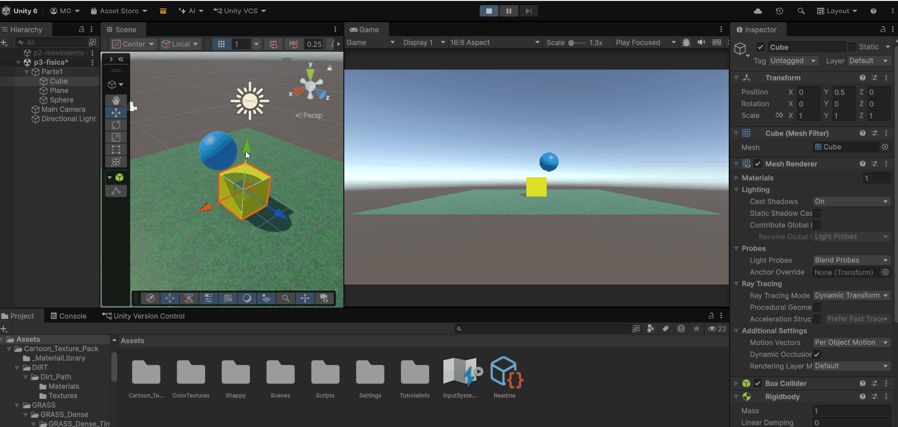

---

### Ejercicio 4

Añadimos un `Rigidbody` al plano (y desactivamos `is Kinematic` en la esfera).
Como todos tienen la gravedad activada, no hay un "suelo firme", por lo que todos los objetos caen y desaparecen de la vista de la cámara.

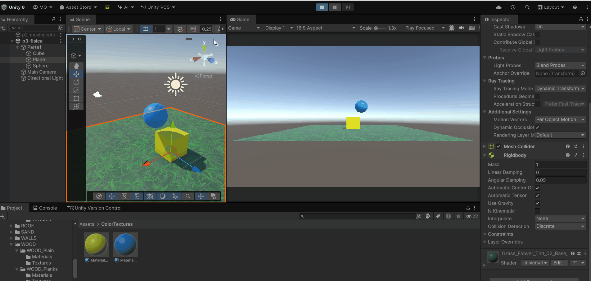

---

### Ejercicio 5

Activamos `is Kinematic` en el plano para que no caiga. Aplicamos una masa de 10 (`Mass` = 10) a la esfera frente a la masa de 1 del cubo. La esfera cae y al chocar con el cubo, este es movido un poquito.

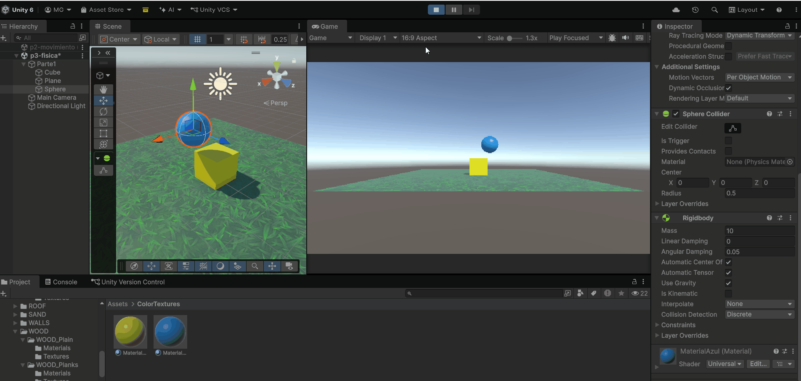

---

### Ejercicio 6

Aplicamos una masa de 100 (`Mass` = 100) a la esfera. El cubo es movido mucho más, y la esfera cae y apenas rueda por el plano.

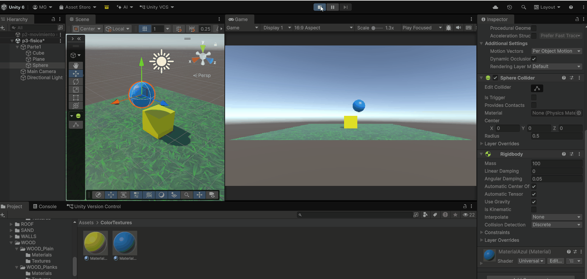

---

### Ejercicio 7

Para cumplir con que el suelo sea objeto físico y que los objetos no caigan, aplicamos un `Rigidbody` al plano y le quitamos la gravedad. Sin embargo, tanto el cubo como la esfera caen y desaparecen de la vista de la cámara. Para ello, hay que poner que el mesh del plano tenga la opción `Convex` activada.
Ahora tendremos un nuevo problema: la fuerza del cubo y la esfera cayendo hace que todos caigan. Para ello, hay que aplicar restricciones de movimiento y rotación al plano, para que no se mueva ni rote.
Finalmente los objetos ya no caen, pero ambos van a rebotar y rodar hasta que se detengan. Esto se debe a que se activó `Convex` y cambia el collider.

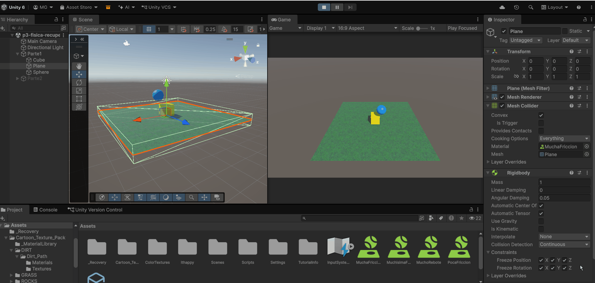

*Para la prueba de la fricción, se asumió que el plano es cinemático. Más tarde me dí cuenta de que podría haber cambiado el collider a un `Box Collider` y no habría hecho falta poner el plano como cinemático.*

La fricción de la esfera fue probada con el cambio de dos valores: `Linear Damping` y `Angular Damping`. Aplicando un `Linear Damping` de 1, la esfera se detiene mucho antes y no cae del plano.

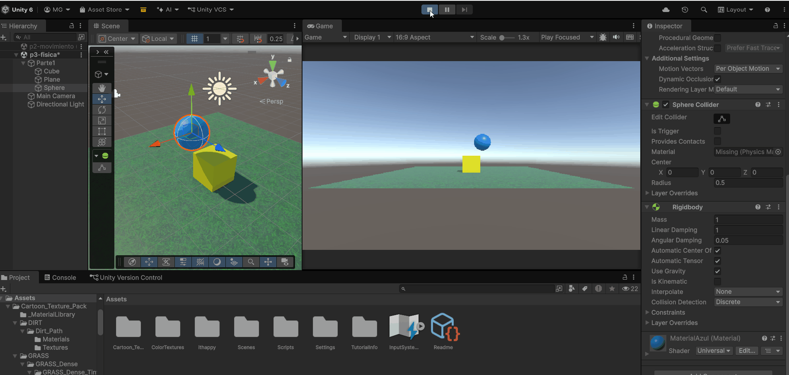

Con un `Angular Damping` de 1, la esfera se detiene algo menos, pero funciona también como fricción.

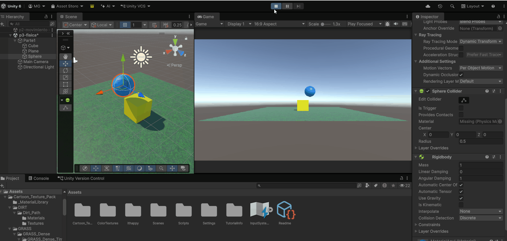

Sin embargo, ambos valores de `Damping` lo que hacen es reducir la velocidad de la esfera independientemente de la superficie del plano, por lo que cuenta más como "fricción del aire". La fricción real se puede aplicar con el `Physic Material` de la esfera con un valor de `Dynamic Friction` de 1, y un `Static Friction` de 1. La esfera tiene el mismo comportamiento que sin aplicar el `Physic Material`.

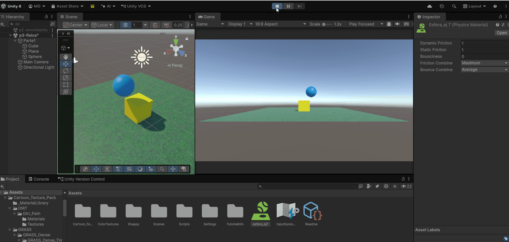

### Ejercicio 8

---

Aplicamos `is Trigger` a la esfera y activamos `is Kinematic`. La esfera ahora no colisiona con otros objetos, sino que los atraviesa. Si hacemos el mismo experimento que en el ejercicio 3, el cubo no es repelido por la esfera, sino que la atraviesa y cae al plano.

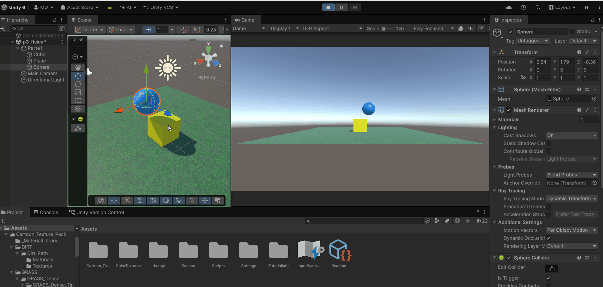

---

### Ejercicio 9

Del ejercicio 8, desactivamos `is Kinematic` en la esfera. La esfera cae y atraviesa tanto el cubo como el plano, desapareciendo de la vista de la cámara.

