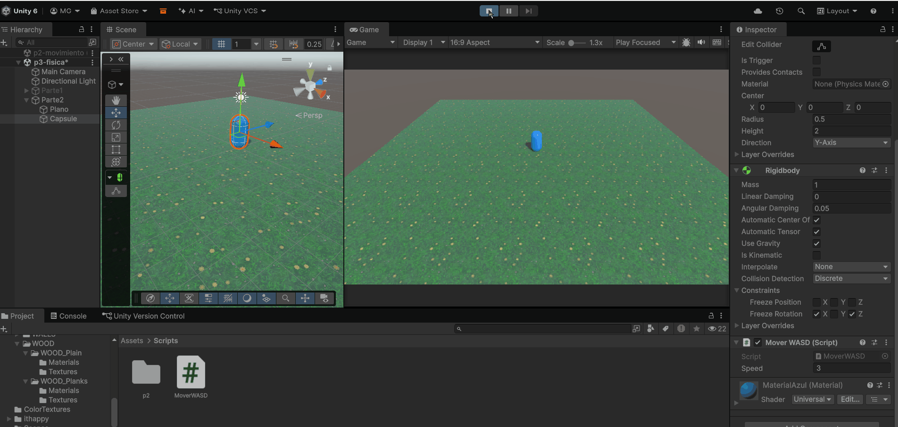
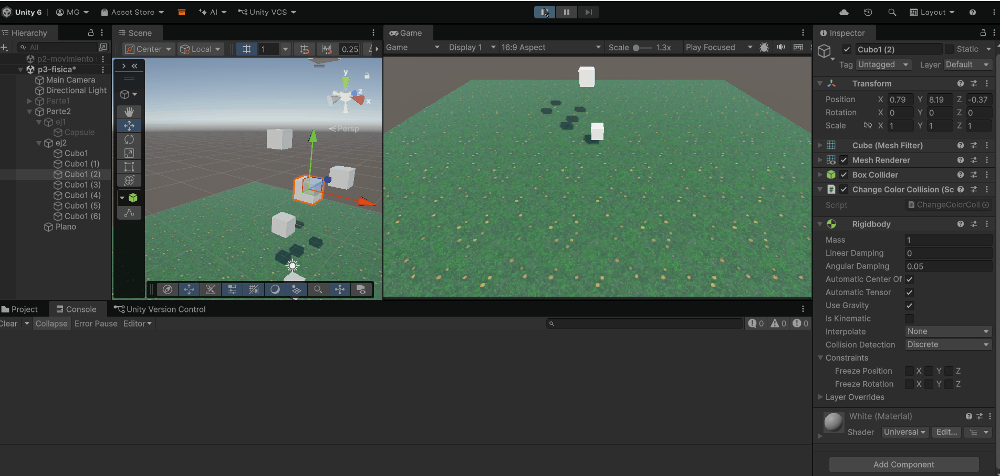
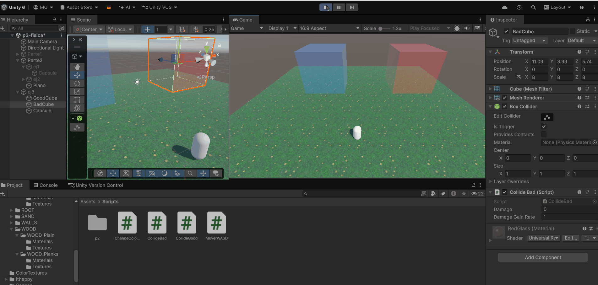
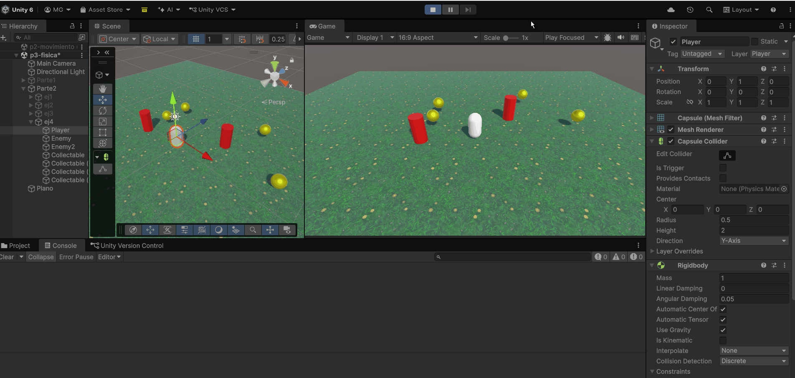
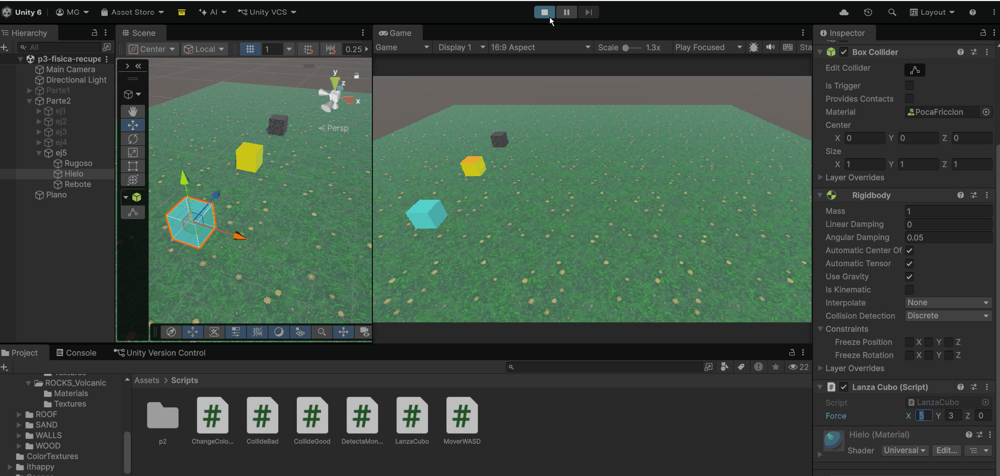
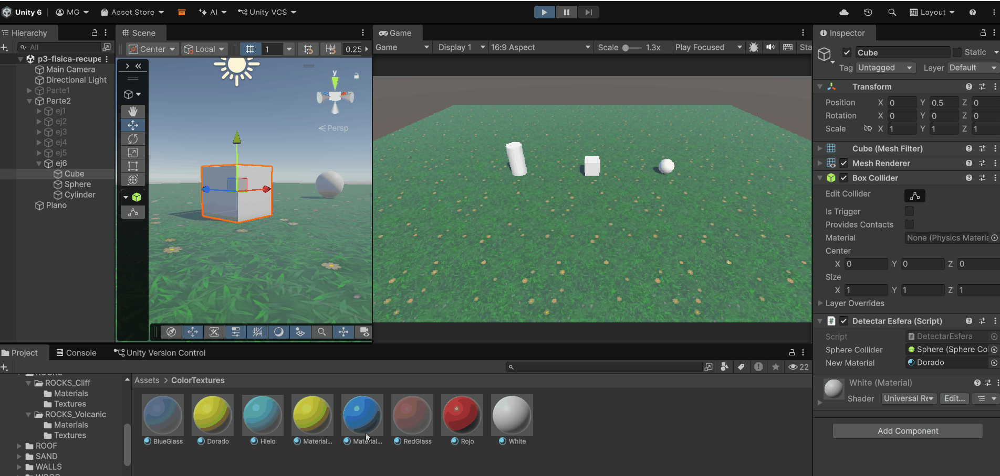

[  ](https://www.ull.es)

# Práctica 3: Movimiento y Físicas

Manuel Cadenas García \<[alu0101636849@ull.edu.es](mailto:alu0101636849@ull.edu.es)\>

---
---

## Parte 2: Físicas 3D - Scripts

### Ejercicio 1

Se crea una cápsula con un `Rigidbody`. Para que no se caiga por los lados, se anula la rotación para los ejes X y Z (estética).
Luego se crea un script en el que tomamos un vector de dirección y un parámetro de velocidad. Después aplicamos el método `MovePosition` al `Rigidbody` para mover la cápsula en la dirección deseada.
La línea que hace la magia es la siguiente:

```csharp
rigidbody.MovePosition(rigidbody.position + speed * Time.fixedDeltaTime * direction);
```

Donde usamos `Time.fixedDeltaTime` para que la velocidad sea constante y no dependa de los FPS.



---

### Ejercicio 2

Se crean varios cubos en distintas posiciones y a todos se les aplica un `Rigidbody` (son clones del cubo original).
Se crea un script que hace que al colisionar (`OnCollisionEnter`) con cualquier objeto, este envíe un mensaje a la consola de con quién colisionó y cambie de color a uno aleatorio de la paleta de colores del arcoíris. Se hizo así por estética, para que se vea mejor el cambio de color. (Luego me di cuenta que hay una posibilidad de aleatoriamente se eligira el mismo color, pero bueno, es un detalle menor).



---

### Ejercicio 3

Se ha creado dos cubos que serán nuestras zonas y se activó `is Trigger` en ambos. Se les ha puesto un color semi-transparente para que se vea el cambio de color al colisionar. Se aprovechó la cápsula del ejercicio 1.

Para el primer cubo se creó un script que, al entrar en la zona, cambia el color de la cápsula a verde y al salir de la zona, cambia el color a blanco. Se usó el método `OnTriggerEnter` y `OnTriggerExit` para detectar la colisión con la zona, respectivamente.

Para el segundo cubo se creó un script que, durante la colisión, se aplica un aumento a la variable `Damage`. Para eso se utilizó el método `OnTriggerStay`, que se ejecuta mientras el objeto esté dentro de la zona.



---

### Ejercicio 4

Se añadieron tres nuevos "layers": Player, Enemy y Collectable. En las opciones de Project Settings > Physics, en la sección de `Layer Collision Matrix`, se desactivó la colisión entre Enemy y todo lo demás, y entre Collectable y todo lo demás. Esto hace que los objetos de esos layers no colisionen con nada. Lo único que se dejó activado es con el Player, para que pueda interactuar con ellos.

Luego se hizo un script que, al colisionar con un objeto, diga por consola que objeto es. En la demostración se ve que el Collectable atraviesa cualquier objeto, pero solo detecta la colisión con el Player.



---

### Ejercicio 5

Se crearon tres cubos con un `Rigidbody`. Luego se añadieron a cada cubo uno de los diferentes `Physic Materials`. Los tres son creados manualmente:
1. `PocaFriccion`: Friction = 0 (dinámica y estática)
2. `MuchaFriccion`: Friction = 1 (dinámica y estática)
3. `Rebote`: Bounciness = 1 (maximum), Friction = 0 (dinámica y estática)

Luego, se creó un script que utilizando `AddForce` hace que los cubos se muevan hacia adelante y algo hacia arriba (es configurable). Los cubos entonces tienen diferentes comportamientos al moverse.



---

### Ejercicio 6

Para que los objetos no utilicen `Rigidbody`, se recicló el script de una práctica anterior que utiliza `LookAt` y `Translate` para mover un objeto hacia otro (de la esfera al cilindro).

En otro script (dentro del cubo) se hace que al colisionar con la esfera, esta cambie de color al material que esté escogido para el cubo. No podemos hacer `OnCollisionEnter` ni `OnTriggerEnter` porque no hay `Rigidbody` con el que colisionar.
En su lugar, se utilizó el componente `Collider` y su componente propio `bounds` para detectar si la esfera está dentro del cubo. Si lo está, se cambia el color de la esfera al color del cubo.

