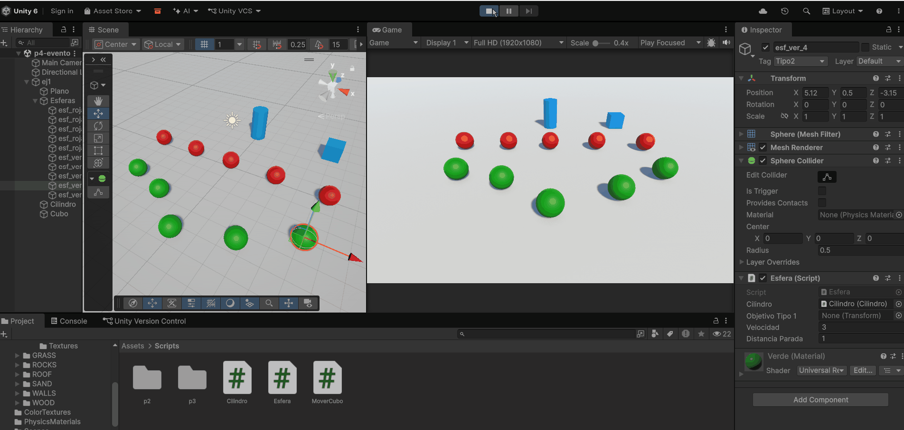
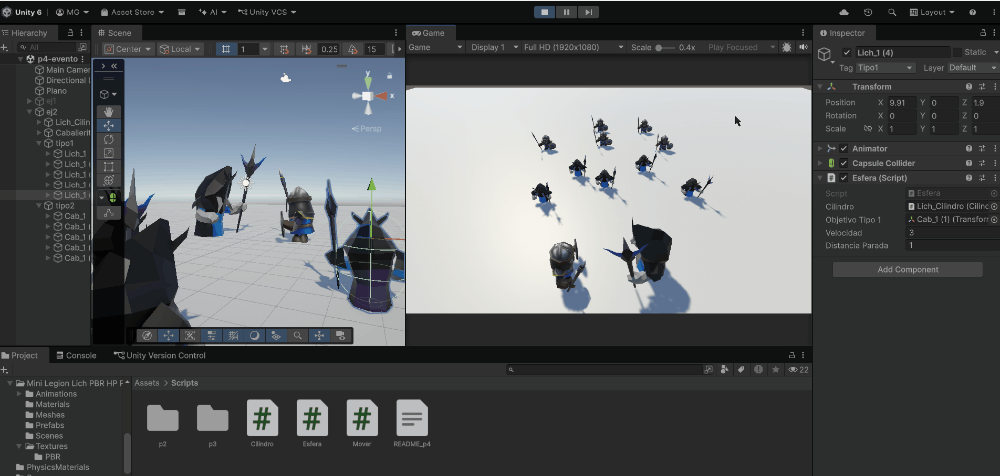
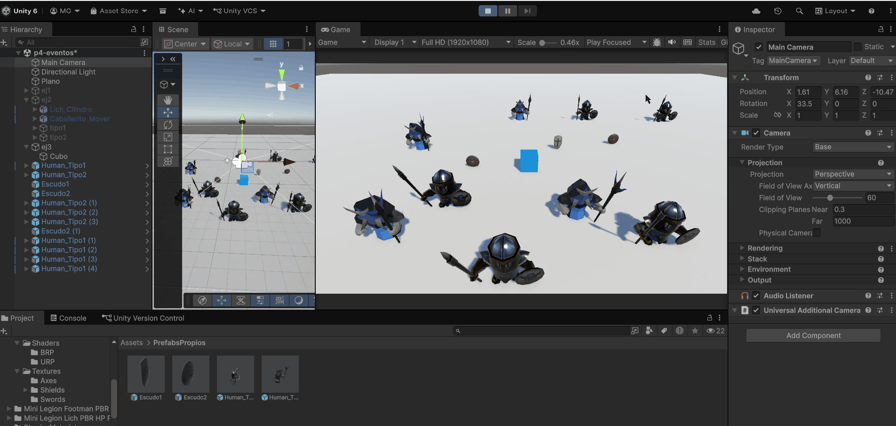
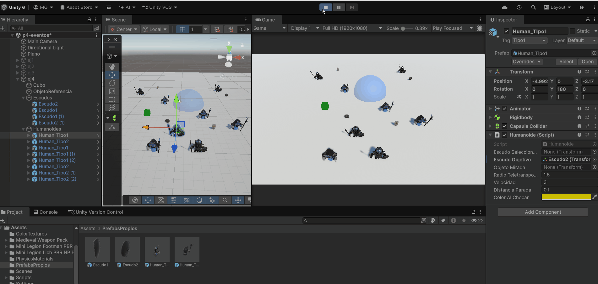
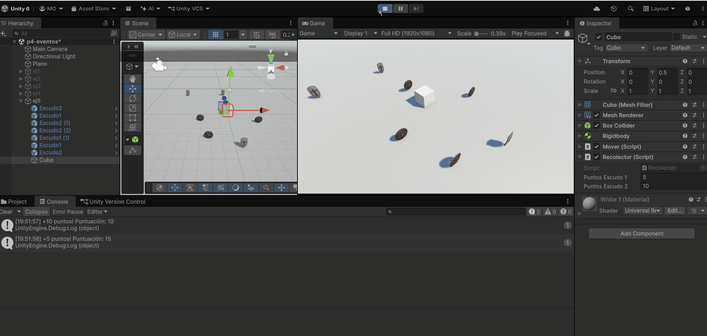
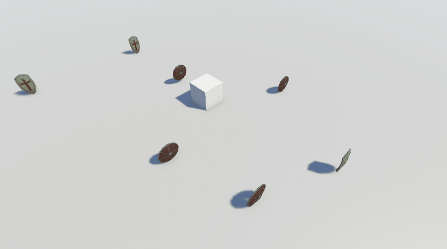
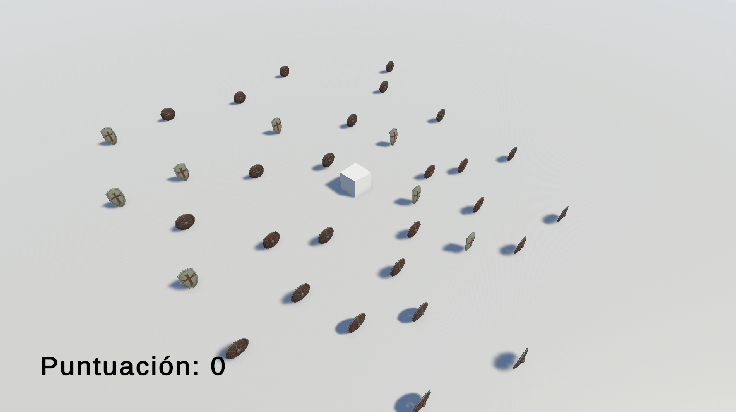
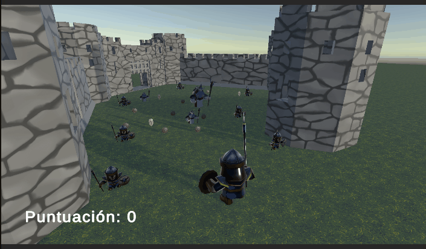

# Práctica 4: Delegados, Eventos

Manuel Cadenas García \<[alu0101636849@ull.edu.es](mailto:alu0101636849@ull.edu.es)\>

---
---

### Ejercicio 1
***Enunciado: Crea una escena con 5 esferas, rojas que las etiquetas de tipo 1, y verdes de tipo 2. Añade un cubo y un cilindro. Crea la siguiente mecánica: cuando el cubo colisiona con el cilindro, las esferas de tipo 1 se dirigen hacia una de las esferas de tipo 2 que fijes de antemano y las esferas de tipo 2 se desplazan hacia el cilindro.***

Se crean 5 esferas rojas con tag Tipo1, 5 esferas verdes con tag Tipo2, con un cilindro y un cubo.
Se hacen tres scripts:
- Cilindro.cs: Se crea un evento que se dispara cuando el cubo colisiona con el cilindro.
  - Usamos `public delegate void MensajeColision()` para definir el tipo de delegado.
  - Usamos `public event MensajeColision OnCuboColisiona` para declarar el evento.
  - Asumimos que el cubo tiene el tag "Cubo" y tiene un `Rigidbody` para que se detecte la colisión.
  - `OnCuboColisiona?.Invoke()` se llama cuando el cubo colisiona con el cilindro, notificando a todos los suscriptores del evento.

- Esfera.cs: Se suscribe al evento del cilindro y dependiendo del tag de la esfera se dirige hacia una esfera de tipo 2 o hacia el cilindro.
  - Usamos `public Cilindro cilindro` para referenciar el cilindro y suscribirse al evento.
  - Usamos `public Transform objetivoTipo1` para referenciar la esfera de tipo 2 hacia la que se moverán las esferas de tipo 1. (Para las esferas de tipo 2 este objetivoTipo1 no se usa, ya que se moverán hacia el cilindro).
  - Usamos `private Transform destino` para almacenar el objetivo actual hacia el que se moverá la esfera.
  - En el método `Start()`, dependiendo del tag de la esfera, nos suscribimos al evento del cilindro con `cilindro.OnCuboColisiona += RespuestaTipo1` o `cilindro.OnCuboColisiona += RespuestaTipo2`.
  - `RespuestaTipo1()` decide que el `destino` es el `objetivoTipo1` (esfera de tipo 2) y `RespuestaTipo2()` decide que el `destino` es el cilindro.
  - En el método `Update()` calculamos la dirección hacia el destino y movemos la esfera hacia él usando `transform.Translate(Time.deltaTime * velocidad * direccion.normalized, Space.World)`.
- MoverCubo.cs: Se mueve el cubo con las teclas de dirección (ayuda para probar la colisión).

---

### Ejercicio 2

***Enunciado: Sustituye los objetos geométricos por humanoides [que encontrarás en el enlace](https://assetstore.unity.com/packages/3d/characters/humanoids/fantasy/mini-legion-footman-pbr-hp-polyart-86576) y [en este enlace](https://assetstore.unity.com/packages/3d/characters/humanoids/fantasy/mini-legion-lich-pbr-hp-polyart-91497)***

Tomamos los modelos de los 'footman', su textura y le damos un rigidbody y un collider (cápsula con restricción de rotación en X y Z). Hacemos lo mismo para los 'lich'. Le damos un tag "Tipo2" a los footman y un tag "Tipo1" a los lich. Se hace lo mismo que en el ejercicio 1, pero ahora con los humanoides.

---

### Ejercicio 3

***Enunciado: Adapta la escena anterior para que existan humanoides de tipo 1 y de tipo 2, así como diferentes tipos de escudos, tipo 1 y tipo 2:***
- Cuando el cubo colisiona con cualquier humanoide  tipo 2,  los del grupo 1 se acercan a un escudo seleccionado. Cuando el cubo toca cualquier humanoide del grupo 1 se dirigen hacia los escudos del grupo 2 que serán objetos físicos. Si algún humanoide a colisiona con uno de ellos debe cambiar de color.***

Se crean los prefabs `Human_Tipo1` y `Human_Tipo2` (humanoides con `Rigidbody`, collider de cápsula y tag Tipo1 y Tipo2 respectivamente) y los prefabs `Escudo1` y `Escudo2` (con tag Escudo1 y Escudo2). Los escudos de tipo 2 llevan además un `Rigidbody` para que sean objetos físicos. Los modelos de escudo proceden de otro paquete de assets distinto al enlazado en el ejercicio 4, que ya no está disponible en la Asset Store.

Los scripts `Cilindro.cs` y `Esfera.cs` se sustituyen por uno solo, `Humanoide.cs`. Ya no hay un notificador aparte: cada humanoide notifica cuando el cubo lo toca y responde a las notificaciones del otro grupo.

- Humanoide.cs: Notifica cuando el cubo lo toca y responde cuando el cubo toca a un humanoide del otro grupo.
  - Usamos `public delegate void Mensaje()` para definir el tipo de delegado y `public static event Mensaje OnCuboTocaTipo1` y `OnCuboTocaTipo2` para declarar los eventos. Son estáticos para que los humanoides no necesiten referencias entre sí.
  - En el método `Start()` se pone el `Rigidbody` como kinematic (los humanoides se mueven con `Transform`, no con el motor de física) y nos suscribimos según el tag: los de tipo 1 a `OnCuboTocaTipo2` con `RespuestaTipo1` y los de tipo 2 a `OnCuboTocaTipo1` con `RespuestaTipo2`.
  - En el método `OnDestroy()` se cancelan las suscripciones con `-=`. Al ser eventos estáticos, un humanoide destruido que siguiera suscrito daría errores.
  - En `OnCollisionEnter()`, si el objeto con el que colisiona tiene el tag Cubo, el humanoide lanza el evento de su propio grupo con `?.Invoke()`. Si el tag es Escudo2, cambia el color de su `Renderer` con `GetComponentInChildren<Renderer>().material.color = colorAlChocar` (amarillo por defecto).
  - Usamos `public Transform escudoSeleccionado` para referenciar el escudo al que se acercarán los humanoides de tipo 1. Se asigna en las instancias de la escena, ya que un prefab no puede guardar referencias a objetos de la escena.
  - `RespuestaTipo1()` decide que el `destino` es el `escudoSeleccionado`.
  - `RespuestaTipo2()` decide que el `destino` es el escudo de tipo 2 más cercano. Se obtienen con `GameObject.FindGameObjectsWithTag("Escudo2")` y se comparan las distancias.
  - En el método `Update()` se mueve el humanoide hacia el destino con `transform.Translate(Time.deltaTime * velocidad * direccion.normalized, Space.World)`, igual que en el ejercicio 1. Si no hay destino no se mueve.
- Mover.cs: Se mueve el cubo con las teclas de dirección usando `Rigidbody.MovePosition()` en `FixedUpdate()`, y se orienta con `Rigidbody.MoveRotation()` hacia la dirección del movimiento.

Para que `OnCollisionEnter()` se llame, al menos uno de los dos objetos de la colisión no debe ser kinematic. El cubo lleva un `Rigidbody` normal, los humanoides son kinematic y los escudos de tipo 2 llevan un `Rigidbody` normal. Los escudos de tipo 1 solo necesitan un collider, ya que ninguna regla depende de sus colisiones.

---

### Ejercicio 4

***Enunciado: Cuando el cubo se aproxima al objeto de referencia, los humanoides del grupo 1 se teletransportan a un [escudo objetivo](https://assetstore.unity.com/packages/3d/props/weapons/shield-61351#content) que debes fijar de antemano. Los humanoides del grupo 2 se orientan hacia un objeto ubicado en la escena con ese propósito.***

Se crea un nuevo notificador, el objeto de referencia, y se amplía `Humanoide.cs` con dos respuestas nuevas, una por grupo.

- ObjetoReferencia.cs: Se crea un evento que se dispara cuando el cubo entra en la zona de proximidad del objeto.
  - Usamos `public delegate void Mensaje()` para definir el tipo de delegado y `public static event Mensaje OnCuboSeAproxima` para declarar el evento.
  - Al objeto de referencia se le añade un `Sphere Collider` con `Is Trigger` activado y mayor que el propio objeto. Un trigger no bloquea a nadie y funciona como una zona invisible; su radio define a qué distancia se considera que el cubo "se aproxima".
  - `OnTriggerEnter(Collider other)` comprueba que `other` tenga el tag Cubo y llama a `OnCuboSeAproxima?.Invoke()`.
- Humanoide.cs (ampliado): Se añaden dos respuestas nuevas al evento anterior.
  - Usamos `public Transform escudoObjetivo` (para los de tipo 1) y `public Transform objetoMirada` (para los de tipo 2) para referenciar los objetos de la escena, asignados en el inspector.
  - En el método `Start()`, los humanoides de tipo 1 se suscriben a `ObjetoReferencia.OnCuboSeAproxima` con `Teletransportar` y los de tipo 2 con `Orientar`. En `OnDestroy()` se cancelan las suscripciones.
  - `Teletransportar()` pone el `destino` a `null`, para que el humanoide deje de moverse hacia el destino anterior, y asigna a `transform.position` la x y la z del `escudoObjetivo` manteniendo su propia y.
  - `Orientar()` usa `transform.LookAt()` hacia la posición de `objetoMirada` con la altura del propio humanoide, de modo que solo gire sobre el eje vertical y no se incline.

---

### Ejercicio 5

***Enunciado: Implementar la mecánica de recolectar escudos en la escena que actualicen la puntuación del jugador. Los escudos de tipo 1 suman 5 puntos y los de tipo 2 suman 10. Mostrar la puntuación en la consola.***

Se crea un script que se añade al cubo y que recoge los escudos con los que colisiona.

- Recolector.cs: Detecta con qué escudo colisiona el cubo, suma los puntos y muestra la puntuación por consola.
  - Usamos `public int puntosEscudo1 = 5` y `public int puntosEscudo2 = 10` para poder cambiar los puntos desde el inspector, y `private int puntuacion` para guardar el total.
  - En `OnCollisionEnter(Collision collision)` se comprueba con `collision.gameObject.CompareTag()` si el objeto es Escudo1 o Escudo2. Se usa el tag y no el nombre del objeto porque las copias de un prefab se nombran `Escudo1 (1)`, `Escudo2 (1)`, etc., y comparar nombres sería frágil.
  - `Recoger(GameObject escudo, int puntos)` suma los puntos a `puntuacion`, destruye el escudo con `Destroy()` y muestra `"+5 puntos! Puntuación: N"` por consola con `Debug.Log()`.
  - Al destruir el escudo en el momento de recogerlo, cada escudo puntúa una sola vez aunque el cubo lo toque varias veces seguidas.

---

### Ejercicio 6

***Enunciado: Partiendo del script anterior crea una interfaz que muestre la puntuación que va obteniendo el cubo.***

Se sigue el mismo patrón que en los ejercicios anteriores: `Recolector.cs` notifica cada cambio de puntuación con un evento y la interfaz se suscribe. El recolector no conoce la interfaz.

- Recolector.cs (modificado): Se añade un evento que se dispara cada vez que cambia la puntuación.
  - Usamos `public delegate void CambioPuntuacion(int puntuacion)` para definir el tipo de delegado y `public static event CambioPuntuacion OnPuntuacionCambia` para declarar el evento.
  - En `Recoger()`, tras sumar los puntos, se llama a `OnPuntuacionCambia?.Invoke(puntuacion)`, pasando la puntuación actual.
- Interfaz.cs: Se suscribe al evento del recolector y actualiza el texto de la pantalla.
  - Usamos `public TextMeshProUGUI textoPuntuacion` para referenciar el texto de la interfaz.
  - En el método `Start()` nos suscribimos con `Recolector.OnPuntuacionCambia += ActualizarPuntuacion` y se inicializa el texto a `"Puntuación: 0"`. En `OnDestroy()` se cancela la suscripción.
  - `ActualizarPuntuacion(int puntuacion)` asigna `"Puntuación: " + puntuacion` a `textoPuntuacion.text`.

En la escena se crea un `Canvas` (GameObject > UI > Canvas) con un texto de TextMeshPro anclado arriba a la izquierda, y un objeto vacío `Interfaz` con el script, al que se arrastra el texto.

---

### Ejercicio 7

***Enunciado: Partiendo de los ejercicios anteriores, implementa una mecánica en la que cada 100 puntos el jugador obtenga una recompensa que se muestre en la UI.***

Se amplían `Recolector.cs` e `Interfaz.cs` con un segundo evento, que notifica cuando se obtiene una recompensa.

- Recolector.cs (modificado): Detecta cuándo la puntuación cruza un múltiplo de 100 y lanza el evento.
  - Usamos `public delegate void RecompensaObtenida(int numero)` y `public static event RecompensaObtenida OnRecompensa`. El parámetro es el número de recompensa obtenida.
  - Usamos `public int puntosPorRecompensa = 100` para poder cambiar el umbral desde el inspector.
  - En `Recoger()` se calcula `puntuacion / puntosPorRecompensa` antes y después de sumar los puntos. Si el cociente aumenta, se llama a `OnRecompensa?.Invoke()`. Comparar antes y después evita perder una recompensa cuando un escudo hace cruzar el múltiplo de 100 sin caer exactamente en él.
- Interfaz.cs (modificado): Se suscribe al nuevo evento y muestra la recompensa durante unos segundos.
  - Usamos `public TextMeshProUGUI textoRecompensa` para el texto de la recompensa y `public string[] recompensas` para la lista de recompensas (`"Espada de madera"`, `"Espada de acero forjada"` y `"Excalibur"`).
  - En `Start()` nos suscribimos con `Recolector.OnRecompensa += MostrarRecompensa`, y en `OnDestroy()` se cancela.
  - `MostrarRecompensa(int numero)` elige `recompensas[(numero - 1) % recompensas.Length]`, de modo que la lista se repite cíclicamente, y muestra `"¡Has conseguido ...!"`.
  - Usamos `Invoke(nameof(OcultarRecompensa), segundosRecompensa)` para borrar el mensaje pasados `segundosRecompensa` segundos (3 por defecto). Antes se llama a `CancelInvoke()` para que una recompensa nueva no sea borrada por el temporizador de la anterior.

Para probarlo sin recoger muchos escudos se baja temporalmente `Puntos Por Recompensa` en el inspector.

---

### Ejercicio 8

***Enunciado: Genera una escena que incluya elementos que se ajusten a la escena del prototipo y alguna de las mecánicas anteriores.***

Se crea un minijuego ambientado en un castillo, de persecución y recolección: el jugador debe recuperar todos los escudos mientras los humanoides enemigos reaccionan a lo que hace. No se escribe ningún script nuevo, solo se reutilizan `Humanoide.cs`, `Mover.cs`, `Recolector.cs`, `Interfaz.cs` y `ObjetoReferencia.cs`, configurándolos desde el inspector.

- Jugador: Un humanoide de tipo 1 al que se le quita el script `Humanoide.cs` y se le asigna el tag Cubo, para que los demás scripts lo detecten sin modificarlos. Lleva un `Rigidbody` no kinematic con la rotación congelada, un collider de cápsula, `Mover.cs` y `Recolector.cs`. La cámara es hija del jugador, por lo que lo sigue sin necesidad de un script.
- Persecución: Se asigna el jugador al campo `escudoSeleccionado` de los humanoides de tipo 1. Como `escudoSeleccionado` es un `Transform` cualquiera, cuando el jugador toca a un humanoide de tipo 2 se lanza `OnCuboTocaTipo2` y los de tipo 1 se dirigen hacia el jugador.
- Defensa: Cuando un humanoide de tipo 1 alcanza al jugador se lanza `OnCuboTocaTipo1` y los de tipo 2 se dirigen al escudo de tipo 2 más cercano, que son los que más puntos dan, y cambian de color al tocarlo.
- Alarma del castillo: Un objeto junto a la puerta lleva `ObjetoReferencia.cs` con su zona trigger. Cuando el jugador se acerca, los humanoides de tipo 1 se teletransportan a un escudo decorativo del castillo y los de tipo 2 se orientan hacia un objeto de la escena. El escudo objetivo tiene el tag Untagged para que el jugador no pueda recogerlo.
- Victoria: Se coloca un número fijo de escudos y se ajusta `puntosPorRecompensa` en el `Recolector` al total de puntos que suman. Al recoger el último escudo se lanza `OnRecompensa` y la interfaz muestra el mensaje.

No hay condición de derrota: los humanoides de tipo 1 se amontonan alrededor del jugador y le cierran el paso, pero no le quitan puntos.

---

### Ejercicio 9

***Enunciado: Implementa el ejercicio 3 siendo el cubo un objeto físico.***

Este ejercicio ya está cubierto por la implementación del ejercicio 3. El cubo lleva un `Rigidbody` no kinematic con gravedad y un collider, y `Mover.cs` lo desplaza con `Rigidbody.MovePosition()` en `FixedUpdate()`. Por tanto, el motor de física gestiona sus colisiones con los humanoides y con los escudos de tipo 2, y las notificaciones se lanzan desde `OnCollisionEnter()` como en el resto de ejercicios.