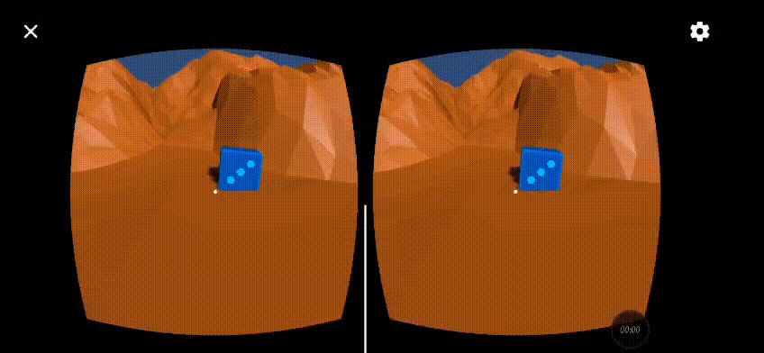

# Práctica 5: Realidad Virtual con Cardboard

Manuel Cadenas García \<[alu0101636849@ull.edu.es](mailto:alu0101636849@ull.edu.es)\>

---
---

### Ejercicio 1
***Enunciado: Crear el proyecto Cardboard y experimentar y generar una apk para Android.***
 
Se crea el proyecto en Unity 6 con el Cardboard XR Plugin siguiendo el [quickstart de Google](https://developers.google.com/cardboard/develop/unity/quickstart), y se importa la escena de ejemplo Hello Cardboard. Se configura el proyecto para Android y se genera el apk con *File > Build Settings > Build*.
 
Para poder compilar hay que corregir un error en `CardboardStartup.cs`. El error es `Please initialize Cardboard XR loader before calling this function`. Se resuelve en la línea de `Api.UpdateScreenParams()`, rodeándola con la directiva de compilación `#if !UNITY_EDITOR ... #endif`, de modo que solo se ejecute en el dispositivo.

(No hay gif porque no pude grabar en un teléfono Android)

---

### Ejercicio 2
***Enunciado: Crea una escena con Cardboard que tenga objetos que al llegar el jugador a ellos los recolecte con la vista. El jugador se puede desplazar con un mando o con la vista. La escena debe contener un terreno y objetos de algún paquete de la Asset Store.***
 
Se crea una escena con un terreno y objetos del paquete LowPoly Environment Pack. Los materiales de este paquete son de colores planos del pipeline Built-in, por lo que se pasan a URP traspasando el color de `_Color` a `_BaseColor`. Se reutiliza el objeto `Player` de la demo, con la jerarquía `Player > Main Camera > CardboardReticlePointer`. Los objetos con los que se puede interactuar se colocan en la capa `Interactive`, que es la que usa el puntero de Cardboard, y llevan un collider.
 
La mecánica sigue el patrón Observador de la práctica anterior. Se hacen tres scripts:
- MovimientoJugador.cs: Mueve al jugador hacia donde mira la cámara mientras se pulsa el botón del Cardboard (o la barra espaciadora en el editor).
  - Se añade un `CharacterController` al `Player` (altura 1,8, radio 0,3). Se usa en lugar de `Translate` para que el jugador colisione con el terreno y siga el relieve.
  - Usamos `public Transform camara` para referenciar la cámara y `public float velocidad` para la velocidad.
  - `Api.IsTriggerPressed` indica si se está pulsando el botón del Cardboard. Dentro de `#if UNITY_EDITOR` se usa `Input.GetKey(KeyCode.Space)` para poder probar sin el móvil.
  - La dirección es la de `camara.forward` con la componente vertical a cero, y se mueve con `SimpleMove()`, que además aplica la gravedad.
- SensorMirada.cs: Se añade a la cámara. Es el notificador: detecta qué objeto se mira y lo notifica.
  - Usamos `public static event Action<GameObject> OnMiradaSeleccionada` para declarar el evento. `Action` es un tipo delegado ya definido por C#, por lo que no hace falta declarar uno propio. Es estático para que los demás scripts no necesiten una referencia al sensor.
  - En `Update()` se lanza un `Physics.Raycast()` desde la cámara hacia delante, con alcance `distanciaMaxima` (6 m). Solo se tienen en cuenta los objetos de la capa `Interactive`.
  - Si se mira el mismo objeto durante `tiempoMirada` (1,5 s) se llama a `OnMiradaSeleccionada?.Invoke(objeto)`. Al cambiar de objeto se reinicia el temporizador.
- Recolectable.cs: Se añade a cada objeto recolectable. Es el observador.
  - Se suscribe a `SensorMirada.OnMiradaSeleccionada` en `OnEnable()` y se da de baja en `OnDisable()`.
  - `AlMirarObjeto()` comprueba con `IsChildOf()` que el objeto mirado es él mismo (o una parte suya). Si lo es, se marca como recolectado y desaparece.
  - Para ocultarlo se desactivan los `Renderer` y los `Collider` en lugar de usar `SetActive(false)`, ya que un objeto desactivado deja de escuchar eventos y tiene que seguir escuchando para el ejercicio siguiente.

(No hay gif porque no pude grabar en un teléfono Android)

---

### Ejercicio 3
***Enunciado: Elige un objeto en la escena que sirva para recuperar los que se recolectan. Cuando el jugador lo selecciona con la vista los recolectables se dirigen hacia el jugador.***
 
Se elige un objeto de la escena como punto de reunión, con collider y en la capa `Interactive`. Se hace un script y se amplía `Recolectable.cs`:
- PuntoReunion.cs: Se añade al punto de reunión. Es observador del sensor y notificador para los recolectables.
  - Usamos `public static event Action<Transform> OnPuntoReunionSeleccionado` para declarar el evento. Envía el `Transform` del jugador como destino.
  - Usamos `public Transform jugador` para referenciar al jugador, asignado en el inspector.
  - Se suscribe a `SensorMirada.OnMiradaSeleccionada` en `OnEnable()` y se da de baja en `OnDisable()`. Si el objeto mirado es el punto de reunión, llama a `OnPuntoReunionSeleccionado?.Invoke(jugador)`.
- Recolectable.cs (ampliado): Se suscribe también al evento del punto de reunión.
  - `AlMirarPuntoReunion()` solo responde si el objeto ya estaba recolectado. Lo vuelve a mostrar y guarda el jugador en `destino`.
  - En `Update()` se mueve hacia el destino con `Vector3.MoveTowards()` hasta quedar a `distanciaParada` (2 m) del jugador, y entonces se detiene.
  - Los objetos que no han sido recolectados ignoran el evento, de modo que el punto de reunión recupera solo los que se han recogido.
Ningún script conoce a los otros: el sensor no sabe quién lo escucha, y los recolectables no conocen el punto de reunión. Se comunican únicamente por eventos.

