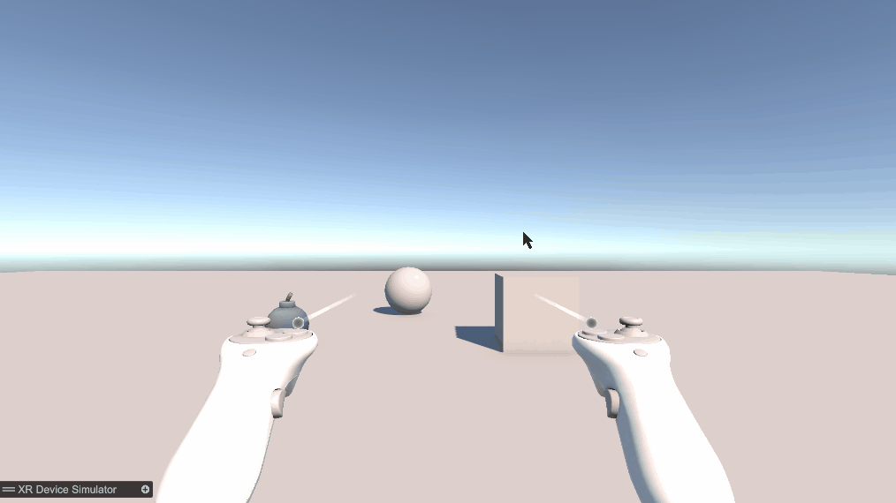

# Práctica 6: Realidad Virtual con XR Interaction Toolkit

Manuel Cadenas García \<[alu0101636849@ull.edu.es](mailto:alu0101636849@ull.edu.es)\>

---
---

### Preparación del entorno
***Enunciado: Instalar XR Interaction Toolkit y un simulador de Meta XR, y dejar el proyecto listo para simular un dispositivo de realidad virtual.***

Se crea un proyecto en Unity 6 y se instalan desde el Package Manager los paquetes `XR Interaction Toolkit`, `XR Plugin Management` y `OpenXR Plugin`. Del paquete XR Interaction Toolkit se importan los samples `Starter Assets`, que incluyen el `XR Origin` y los prefabs de los mandos ya configurados, y `XR Device Simulator`.

En `Project Settings > XR Plug-in Management` se activa **OpenXR** en la pestaña de PC (Standalone), ya que se prueba en el simulador y no en unas gafas. En los ajustes de OpenXR se añade el perfil `Oculus Touch Controller Profile`, y se aplica `Fix All` a los avisos que aparecen en la validación del proyecto. La plataforma Android no se toca porque no se genera ninguna compilación para Quest.

Como simulador se usa el `XR Device Simulator` del propio XR Interaction Toolkit, en lugar del Meta XR Simulator, que el guion permite como alternativa. Con él se controlan la cabeza y los dos mandos con teclado y ratón.

---

### Ejercicio
***Enunciado: Agrega en la escena un cubo, una esfera y un objeto de la asset store que elijas sobre un plano, cada uno de ellos a diferentes distancias. El cubo y esfera serán Ray Interactor que cambian de color al seleccionarlo. El objeto de la asset store será un Direct Interactor que actualiza la UI al agarrarlo.***

Se parte de una escena nueva en la que se elimina la `Main Camera`, porque el rig XR trae su propia cámara, y se añaden el prefab `XR Origin (XR Rig)` de los Starter Assets y el `XR Device Simulator`. Sobre un `Plane` en el origen se colocan el cubo, la esfera y una bomba de la Asset Store, a distintas distancias del jugador y siempre delante de él. Los tres objetos llevan un `Collider`, un `Rigidbody` y un componente `XR Grab Interactable`, que es lo que los hace detectables y agarrables por los interactores.

Para la interfaz se crea un `Canvas` en modo `World Space`, situado frente al jugador, con un texto de TextMeshPro que muestra el estado.

La mecánica se apoya en los eventos del `XR Grab Interactable` (`Select Entered` y `Select Exited`), que se configuran desde el inspector. Es la misma idea del patrón Observador de la práctica 4: el interactuable notifica que ha sido seleccionado o soltado, y los scripts se limitan a responder, sin que el interactuable sepa quién escucha. Se hacen dos scripts:
- CambioColor.cs: Se añade al cubo y a la esfera.
  - Usamos `public Color colorSeleccionado` para elegir el color desde el inspector, de modo que cada objeto puede tener uno distinto.
  - En `Start()` se obtiene el `Renderer` y se guarda el color original del material.
  - `Seleccionado()` aplica `colorSeleccionado` al material y `Soltado()` restaura el color original.
  - En el `XR Grab Interactable` de cada objeto, `Select Entered` llama a `Seleccionado()` y `Select Exited` llama a `Soltado()`.
- ActualizarUI.cs: Se añade al `Canvas`.
  - Usamos `public TMP_Text texto` para referenciar el texto de la interfaz, asignado en el inspector.
  - `Agarrado()` cambia el texto a "Objeto agarrado" y `Soltado()` lo devuelve a "Nada agarrado".
  - En el `XR Grab Interactable` de la bomba, `Select Entered` llama a `Agarrado()` y `Select Exited` llama a `Soltado()`.

Al apuntar con el rayo y seleccionar el cubo o la esfera, el objeto cambia de color mientras está agarrado y recupera el original al soltarlo. La bomba se coge acercándole la mano y, mientras se tiene agarrada, el texto de la interfaz indica que hay un objeto agarrado.

